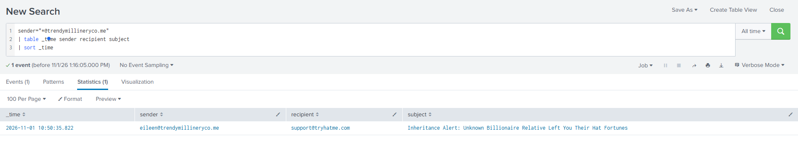
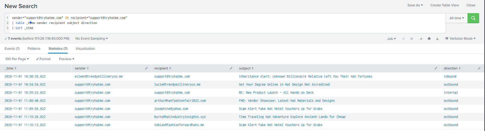
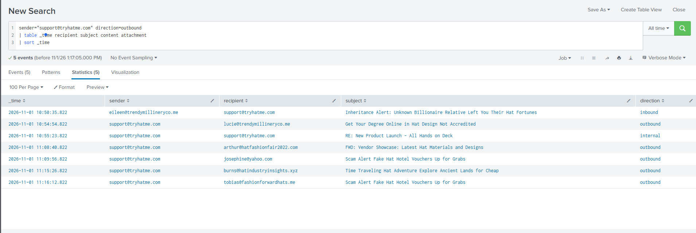

# Alert 1000: Suspicious Email from External Domain

| Field | Value |
|---|---|
| Alert ID | 1000 |
| Alert rule / type | Suspicious email from external domain / Phishing |
| Initial severity | Low |
| Date worked | 2026-11-01 |
| Environment | TryHackMe SOC Simulator, scenario "Phishing Unfolding" |
| Analyst | King FJ Tolentino (Tier 1, practice environment) |
| Tools | Splunk |
| Verdict | **True Positive** (malicious inbound email) |
| Final severity | Low |
| Status | Closed. Follow-up items listed below. |

> Note on timestamps: the simulator session restarted during this exercise. All times below come from the second session and were taken between 11:10 and 11:36 on 2026-11-01. The data keeps growing while the scenario runs, so each search lists its "as of" time.

---

## Findings

The alert is a true positive. An inbound email from `eileen@trendymillineryco[.]me` to `support@tryhatme[.]com` claimed the recipient had inherited a fortune and asked for banking details immediately. It contained no link and no attachment. I found no evidence that the recipient replied or sent any banking information.

After the email arrived, the `support@tryhatme[.]com` mailbox sent five outbound promotional emails and one internal email. None contained a link, an attachment, or a request for information. The logs cannot show who or what used the mailbox, so that remains an open item. I did not find evidence linking this alert to the endpoint activity on host `win-3450` seen elsewhere in this scenario.

## Investigation Summary

1. Copied the alert and noted its fields: sender, recipient, subject, content, attachment, direction.
2. Searched Splunk for the sender domain across all time. One event came back: a single email to `support@tryhatme[.]com`. No other recipients, so no sign of a wider campaign from that domain.
3. Searched the mailbox in both directions (sender or recipient). This showed the inbound email followed by outbound and internal emails from the mailbox.
4. Read the content and attachment fields of every outbound email. All showed `attachment: None` and no URLs.
5. Compared the outbound emails against the mailbox's history. The earliest outbound email in the data is after the scam email, so there is no baseline of normal activity for this mailbox.
6. Checked the spacing of the outbound emails. The gaps were irregular, which does not fit a simple scheduled tool. This weakens one kind of misconfiguration but does not identify who or what sent them.
7. Checked which data sources exist (`sysmon`, `email`, `powershell`). There is no sign-in or authentication log, so the logs cannot show who used the mailbox.

## Who, What, When, Where, Why, How

- **Who:** Sender `eileen@trendymillineryco[.]me`. Recipient `support@tryhatme[.]com`.
- **What:** An inbound advance-fee style scam email demanding banking details, followed by unexpected outbound promotional email from the same mailbox.
- **When:** Email logged 10:49:13 and alert time field 10:49:26 (13-second difference). Alert raised 10:51. Outbound activity 10:53 to 11:14 as of 11:36. Timezone is the simulator's local time. Whether it is still ongoing: new outbound events kept appearing while I was investigating.
- **Where:** Email data source, inbound to the support mailbox, then outbound and internal from the same mailbox.
- **Why:** Indicators of a scam: an unsolicited inheritance from an unknown "relative", urgency, a request for banking details, an unusual `.me` domain posing as a hat company. The intent appears to be collecting banking information.
- **How:** Delivered by email to a shared support address. No link or attachment was used, so the attack depends on the recipient replying with personal data. The logs show no reply.

## Timeline (second session)

| Time | Event | Source |
|---|---|---|
| 10:49:13 | Inbound scam email logged | email |
| 10:51 | Alert 1000 raised | alert queue |
| 10:53:32 | Outbound to `lucie@trendymillineryco[.]me`, subject "Get Your Degree Online in Hat Design Not Accredited" | email |
| 10:54:01 | Internal email, subject "RE: New Product Launch - All Hands on Deck" | email |
| 11:07:18 | Outbound to `arthur@hatfashionfair2022[.]com`, subject "FWD: Vendor Showcase: Latest Hat Materials and Designs" | email |
| 11:08:34 | Outbound to `josephine@yahoo[.]com`, subject "Scam Alert Fake Hat Hotel Vouchers Up for Grabs" | email |
| 11:14:04 | Outbound to `burns@hatindustryinsights[.]xyz`, subject "Time Traveling Hat Adventure Explore Ancient Lands for Cheap" | email |
| 11:14:50 | Outbound to `tobias@fashionforwardhats[.]me`, same "Scam Alert" subject and identical body as 11:08:34 | email |

## Evidence







## Splunk Queries Used

```
sender="*@trendymillineryco.me"
| table _time sender recipient subject
| sort _time
```
Finds every email sent from the suspect domain, oldest first.

```
sender="support@tryhatme.com" OR recipient="support@tryhatme.com"
| table _time sender recipient subject direction
| sort _time
```
Shows the mailbox's traffic in both directions in one timeline.

```
sender="support@tryhatme.com" direction=outbound
| table _time recipient subject content attachment
| sort _time
```
Shows the body and attachment status of each outbound email, so the "no links, no attachments" claim is backed by evidence.

## Verdict and Reasoning

**True positive, high confidence for the inbound email.** The subject, urgency, request for banking details and mismatched domain together make it a scam attempt. **Severity stays Low:** no link, no attachment, and no evidence that the recipient responded.

The mailbox's outbound behavior is not part of this verdict. It is unexpected for a support mailbox, but it cannot be classified from the available logs.

## What the Evidence Does Not Show

- Who or what sent the outbound emails. No sign-in logs are available.
- Whether the support mailbox was compromised. No mechanism for compromise was found, and the email contained no link or attachment.
- Whether the recipient read the email. The logs show delivery only.
- Any connection to the endpoint activity on `win-3450`. No shared user, host or indicator was found.

## Recommendations

1. Block the sender address and the domain `trendymillineryco[.]me` at the mail gateway.
2. Remove the email from the support mailbox and notify the recipient not to reply or share banking details.
3. Ask the mailbox owner whether they sent the outbound emails, and review sign-in logs for `support@tryhatme[.]com` if they exist outside this data set.
4. Review the five outbound recipients and consider notifying them if the emails were not authorized.
5. Detection tuning: the SOC Lead noted this rule needs fine-tuning. An unusual top-level domain alone is weak. Combining it with content indicators (financial requests, urgency) would reduce noise.

## MITRE ATT&CK

| Tactic | Technique | ID |
|---|---|---|
| Initial Access | Phishing | T1566 |

## Lessons Learned

- My first read of the case assumed the mailbox had been taken over. The evidence did not support that: there was no link or attachment, and no sign-in data to prove it. I changed the theory to "unknown, pending sign-in logs."
- A search that returns zero results can mean a typo, a wrong time range or a field name mismatch, not that nothing happened. Several of my searches needed correcting.
- I mistyped the company domain twice while working. Indicators have to be copied exactly from the logs.
- The simulator data grew and restarted during the exercise. Recording an "as of" time for each search keeps the report consistent.

